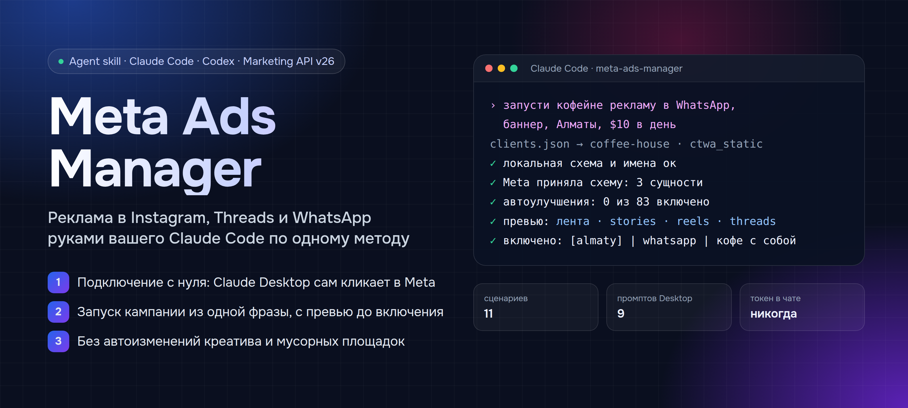
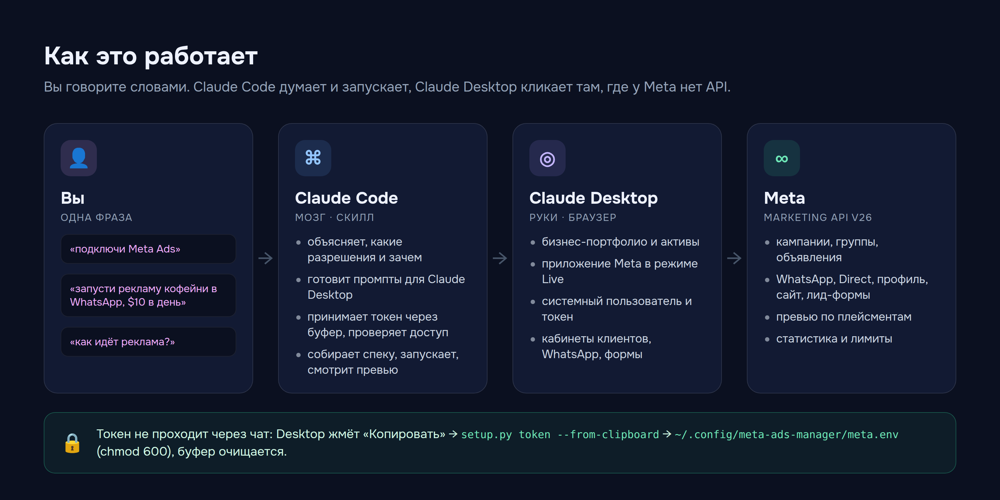
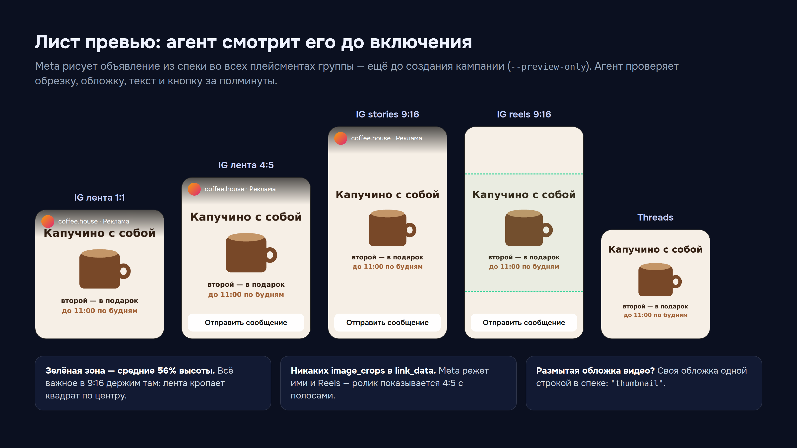

<p align="center">
  
</p>

<p align="center">
  <a href="LICENSE"></a>
  
  
  
  
  
</p>

# Meta Ads Manager — реклама Meta руками вашего Claude Code

**Скилл для Claude Code и Codex**, который ведёт рекламу в Instagram, Threads, WhatsApp и Facebook через официальный
Marketing API — по одному отработанному методу для всех кабинетов. Вы пишете «запусти кофейне рекламу в WhatsApp,
баннер, Алматы, $10 в день» — агент собирает кампанию, проверяет её на стороне Meta, смотрит превью во всех
плейсментах и включает.

А если у вас ещё нет ни приложения Meta, ни токена — агент проведёт через подключение с нуля: объяснит, какие
разрешения нужны и зачем, и подготовит пошаговые промпты для **Claude Desktop**, который сам прокликает
business.facebook.com и developers.facebook.com в вашем браузере.

> **English.** Agent skill for Claude Code and Codex: run Meta ads (Instagram, Threads, WhatsApp, Facebook) through the
> Marketing API v26 with one opinionated method — JSON-spec launches, server-side validation, placement preview sheets,
> no creative auto-enhancements, no Audience Network/Marketplace. Includes a guided onboarding where Claude Code writes
> step-by-step prompts for Claude Desktop to set up the business portfolio, app, system user and token in the browser.
> Docs are in Russian; agents read them fine.

## Что умеет

| | |
|---|---|
| 🔌 **Подключение с нуля** | интервью → промпты для Claude Desktop → токен системного пользователя через буфер обмена → `doctor.py` проверяет доступ |
| 🚀 **Запуск из одной фразы** | кампания → группы → креативы → объявления из JSON-спеки; проверка Meta до создания; повтор досоздаёт недостающее |
| 💬 **11 сценариев** | WhatsApp, Instagram Direct, трафик на профиль, продвижение готового поста/рилса, лид-формы, сайт с пикселем — картинки и видео |
| 🖼 **Лист превью** | Meta рисует объявление во всех плейсментах ещё до запуска; агент проверяет обрезку, обложку и кнопку |
| 🛡 **Метод в коде** | автоизменения креатива выключены, Audience Network и Marketplace заблокированы, аудитория не расширяется |
| 📊 **Работа каждый день** | бюджеты, пауза, включение, дубли, замена креатива, статистика с ценой результата, лог всех изменений |
| 👥 **Клиенты** | один токен на все кабинеты: клиент даёт партнёрский доступ, `doctor.py discover` записывает его в `clients.json` |

<p align="center"></p>

## Установка

**Скажите своему агенту** (Claude Code или Codex):

> Установи скилл https://github.com/artemmarketolog/meta-ads-manager: склонируй в папку скиллов, запусти
> `python3 setup.py` и подключи меня к Meta Ads по `references/onboarding.md`.

**Или вручную:**

```bash
git clone https://github.com/artemmarketolog/meta-ads-manager ~/.claude/skills/meta-ads-manager   # Claude Code
# или ~/.agents/skills/meta-ads-manager — для Codex и других агентов
cd ~/.claude/skills/meta-ads-manager
python3 setup.py          # своё окружение .venv + ~/.config/meta-ads-manager/{meta.env, clients.json}
python3 setup.py --check
```

Нужны: Python 3.10+, macOS / Linux / Windows через WSL. Для листа превью — Google Chrome (необязательно).
Для подключения — **Claude Desktop с доступом к браузеру** (Claude in Chrome) на компьютере, где вы входите в Facebook.

## Подключение к Meta — 20–40 минут, кликает Claude Desktop

Скажите агенту **«подключи Meta Ads»**. Он задаст 4 вопроса и дальше будет выдавать по одному промпту — вы вставляете
его в Claude Desktop и возвращаете отчёт. Все промпты лежат в [`prompts/desktop/`](prompts/desktop), агент подставляет
в них ваши названия и ID, а сверху — [общие правила](prompts/_rules.md): пароли и коды вводите только вы, токены не
показываются, деньги и реклама не трогаются, ничего не удаляется.

| Шаг | Промпт | Что делает Claude Desktop |
|---|---|---|
| 1 | [01 · Снять показания](prompts/desktop/01-audit.md) | только читает: портфолио, кабинеты, страницы, приложения, уровень доступа |
| 2 | [02 · Бизнес-портфолио](prompts/desktop/02-business-portfolio.md) | создаёт портфолио, добавляет ваш кабинет, страницу и Instagram |
| 3 | [03 · Приложение](prompts/desktop/03-create-app.md) | создаёт приложение с Marketing API, политика конфиденциальности, режим Live |
| 4 | [04 · Системный пользователь и токен](prompts/desktop/04-system-user-token.md) | робот портфолио, доступ к кабинетам и страницам, бессрочный токен → «Копировать» |
| 5 | агент | `setup.py token --from-clipboard` → проверка в Meta → `doctor.py` |
| + | [05 · Новый клиент](prompts/desktop/05-client-access.md) | текст для клиента + назначение его кабинета, страницы, Instagram роботу |
| + | [06 · WhatsApp](prompts/desktop/06-whatsapp-link.md) · [07 · Лид-форма](prompts/desktop/07-lead-form.md) | привязка номера к странице; мгновенная форма |
| + | [08 · Full access](prompts/desktop/08-full-access.md) · [09 · Отзыв токена](prompts/desktop/09-revoke-token.md) | повышение лимитов через 1–2 недели; аварийный отзыв |

Какие разрешения отмечаются и зачем каждое — [`references/permissions.md`](references/permissions.md).
Как устроены портфолио, приложение, системный пользователь и лимиты — [`references/app-setup.md`](references/app-setup.md).

```text
$ .venv/bin/python scripts/doctor.py
🔑 токен …a1B2
✅ тип SYSTEM_USER | приложение Coffee Agency Ads | срок: бессрочно
✅ разрешения: все 9 нужных на месте
✅ кабинетов: 4
⚠️ Marketing API: Limited access — большие запуски делите на части; через 1–2 недели промпт 08
```

## Как пользоваться

Говорите обычными словами — агент сам выберет сценарий, соберёт спеку и проверит её.

| Вы говорите | Что происходит |
|---|---|
| «запусти кофейне рекламу в WhatsApp, баннер, $10 в день» | спека `ctwa_static` → проверка Meta → кампания → превью → включение |
| «подготовь рекламу на сайт этим роликом, не запускай» | спека + `--validate-only` + лист превью, без включения |
| «продвинь вчерашний рилс на профиль, $5 в день» | `ig-media` → `ig_profile_post`: как «Продвигать», но без даты окончания и автоулучшений |
| «как идёт реклама у кофейни за неделю?» | `insights` по кампаниям: расход, переписки/лиды, цена результата |
| «подними бюджет группы X до $15», «выключи всё у кофейни» | `budget`, `batch-pause` с readback |
| «новый клиент — пекарня» | промпт 05 для клиента → `doctor.py discover --write` |
| «выключи кампанию завтра в 9 утра» | отложенная команда паузы (не `end_time`) |

Под капотом — две команды, ими можно пользоваться и самому:

```bash
PY=.venv/bin/python
$PY scripts/meta_launch.py --spec examples/specs/ctwa_static.json --dry-run        # без запросов к Meta
$PY scripts/meta_launch.py --spec spec.json --validate-only                        # Meta проверяет, ничего не создаёт
$PY scripts/meta_launch.py --spec spec.json --preview-only                         # лист превью до запуска
$PY scripts/meta_launch.py --spec spec.json --check-previews --activate            # запуск целиком
$PY scripts/meta_api.py status campaign <id>
$PY scripts/meta_api.py insights act_<id> --preset=last_7d --level=campaign
```

Готовые спеки для каждого сценария — [`examples/specs/`](examples/specs), полное руководство агента — [SKILL.md](SKILL.md).

<p align="center"></p>

## Правила метода

Каждое правило появилось после реального слитого бюджета или испорченного объявления — и зашито в код, а не в
инструкцию, поэтому агент не может его «забыть».

| Правило | Почему |
|---|---|
| **Креатив не меняет Meta** — все автоулучшения OPT_OUT, мультиобъявления выключены | без явного запрета Meta сама дорисовывает фон, текст, музыку и меняет кнопку |
| **Только Instagram + Threads по умолчанию**, Facebook — по просьбе | ролик показывается целиком; плейсменты меняются одной строкой `META_DEFAULT_PLATFORMS` |
| **Audience Network и Marketplace — никогда** | дешёвые показы, которые не приводят клиентов; автоплейсменты тоже блокируются |
| **Аудитория не расширяется** | ручные возраст, пол и гео Meta не «улучшает» |
| **Одна группа — одно объявление, бюджет на группе** | видно, какой креатив работает; бюджет переносится руками |
| **Сначала выключенным, потом проверка и превью** | `ACTIVE` без работающего превью = 0 показов |
| **Без `image_crops` в обычных объявлениях** | Meta режет ими и Reels — ролик показывается 4:5 с полосами |
| **Метки сайта по названиям** | заявки в CRM сравниваются по имени объявления и группы, без ID |
| **Понятные имена** `[гео] \| цель \| оффер \| дата` | через месяц в кабинете видно, что это было |

## Ваши данные остаются у вас

| Что | Где |
|---|---|
| Токен и настройки | `~/.config/meta-ads-manager/meta.env` (chmod 600) |
| Клиенты: кабинеты, страницы, номера, пиксели | `~/.config/meta-ads-manager/clients.json` (chmod 600) |
| State запусков и листы превью | `~/.local/share/meta-ads-manager/state/` |
| Лог изменений (без токенов и текстов) | `~/.local/share/meta-ads-manager/logs/meta_api_writes.log` |

Запросы уходят только в `graph.facebook.com`. Никакой телеметрии, ботов и сторонних серверов. Токен не проходит через
чат: только буфер обмена или скрытый ввод в терминале. Подробно — [SECURITY.md](SECURITY.md).

## Проверка без трат

```bash
.venv/bin/python -m unittest discover -s tests -v                           # 40 тестов, без сети
for f in examples/specs/*.json; do .venv/bin/python scripts/meta_launch.py --spec "$f" --dry-run; done
```

## Частые вопросы

<details><summary><b>Зачем приложение и системный пользователь, если можно взять токен в Graph API Explorer?</b></summary>

Токен из Explorer личный: доступ к данным кончается каждые 90 дней и зависит от вашей сессии Facebook. Токен системного
пользователя бессрочный, видит только назначенные активы и не ломается от смены пароля. К тому же прерванное окно
разрешений Explorer молча отклоняет разрешения — и запись в кабинеты перестаёт работать.
</details>

<details><summary><b>Нужна ли проверка приложения (App Review)?</b></summary>

Нет. Для своих кабинетов и кабинетов клиентов, которые дали доступ вашему бизнес-портфолио, хватает стандартного доступа.
App Review нужен, только если в ваше приложение будут входить посторонние люди своими аккаунтами Facebook.
</details>

<details><summary><b>«Limited access» — это проблема?</b></summary>

Нет, так стартует любое новое приложение: ~20 изменений за 5 минут на кабинет. Скрипты на лимите останавливаются без
повторов и продолжают той же командой. Через 1–2 недели обычной работы (500 вызовов за 15 дней) нажмите Upgrade — промпт 08.
</details>

<details><summary><b>Я случайно вставил токен в чат.</b></summary>

Не используйте его. Промпт 09 отзывает токен за минуту, промпт 04 (шаги 4–5) выпускает новый.
</details>

<details><summary><b>Объявления не создаются: ошибка 1885183.</b></summary>

Приложение в режиме разработки. Переведите его в Live (промпт 03, пункт 4) и выпустите токен заново.
</details>

<details><summary><b>Claude Code работает на сервере, а браузер — на ноутбуке.</b></summary>

Claude Desktop кликает на ноутбуке как обычно. Токен сохраните на сервере сами: `python3 setup.py token` в терминале
сервера — ввод скрытый.
</details>

Остальные ошибки Meta и что с ними делать — [`references/errors.md`](references/errors.md).

## Структура

```
SKILL.md                    руководство агента: правила, pipeline, команды
setup.py                    установка, приём токена (буфер / скрытый ввод)
scripts/
  meta_api.py               все write-операции: создание, бюджеты, пауза, дубли, превью, статистика
  meta_launch.py            запуск дерева из JSON-спеки, state, продолжение после сбоя
  meta_launch_builders.py   схемы 11 сценариев и валидаторы (без сети)
  doctor.py                 проверка доступа и поиск страниц, Instagram, пикселей, WhatsApp
prompts/                    промпты для Claude Desktop и общие правила
references/                 подключение, разрешения, сценарии, обрезка, WhatsApp/Instagram, лимиты, ошибки
examples/                   спеки для каждого сценария, пример clients.json, демо-медиа
tests/                      тесты без сети и трат
```

## Связанные скиллы

- [image-gen](https://github.com/artemmarketolog/image-gen) — баннеры и фото для креативов через GPT Image.
- [motion-video](https://github.com/artemmarketolog/motion-video) — рекламные ролики 9:16 кодом.
- [elevenlabs-voice](https://github.com/artemmarketolog/elevenlabs-voice) — озвучка роликов.

## Лицензия

MIT — см. [LICENSE](LICENSE). Meta, Instagram, Threads, WhatsApp и Facebook — товарные знаки Meta Platforms, Inc.;
скилл не связан с Meta и использует публичный Marketing API по его условиям.
